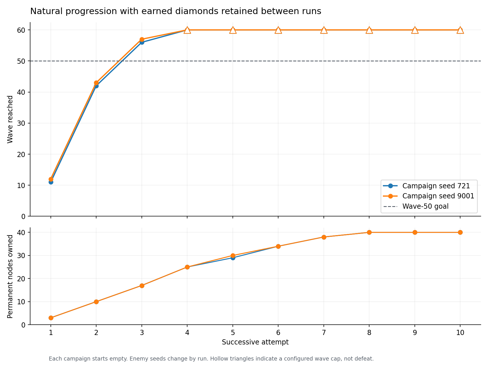

# Earned-progression balance experiments (v0.6)

Natural combat uses the real main scene, placement transactions, target selection,
projectiles, gold rewards and diamond research. Each campaign starts with an empty
profile and normal 200 gold / 10 lives. A new scene resets run resources between
attempts; the isolated profile is saved and reloaded between attempts.
Research and unspent diamonds carry forward. No test assigns combat stats,
skips waves, clears enemies or grants resources in a natural campaign.

## Full ten-attempt validation

Both campaigns meet the target: first natural defeats on **waves 11 and 12**,
then **wave 50 cleared on attempt three with all ten lives**, rather than requiring
ten attempts. Attempts three end naturally on waves 56 and 57. Attempts 4–10
all clear the configured **wave-60 cap**; their actual survival endpoints remain
unmeasured. No further research discounts or base tower buffs were needed.

| Attempt | Seed 721: wave reached | Seed 9001: wave reached | Research owned (721 / 9001) | Diamonds banked (721 / 9001) |
| --- | --- | --- | --- | --- |
| 1 | 11 | 12 | 3 / 3 | 1 / 2 |
| 2 | 42 | 43 | 10 / 10 | 5 / 7 |
| 3 | 56 | 57 | 17 / 17 | 4 / 7 |
| 4 | 60+ | 60+ | 25 / 25 | 6 / 9 |
| 5 | 60+ | 60+ | 29 / 30 | 18 / 1 |
| 6 | 60+ | 60+ | 34 / 34 | 2 / 5 |
| 7 | 60+ | 60+ | 38 / 38 | 11 / 14 |
| 8 | 60+ | 60+ | 40 / 40 | 39 / 42 |
| 9 | 60+ | 60+ | 40 / 40 | 99 / 102 |
| 10 | 60+ | 60+ | 40 / 40 | 159 / 162 |

**60+ means capped while alive**, not defeat at 60. A defeated wave awards no
diamond: the two campaigns' initial runs clear 10 and 11 waves respectively.
Each attempt starts with 200 gold and 10 lives; only diamonds and permanent nodes
carry over. Both profiles complete the 367-diamond tree during attempt eight.

[Primary raw report](final/builder-721.json) · [Second raw report](final/builder-9001.json) · [Campaign CSV](campaigns.csv)



[Standalone SVG](progression.svg). Hollow triangles mark capped survival.
The two campaigns total **33.9 hours of simulated combat**, processed at
1/30 second per tick. All 20 attempts passed source integrity, exact profile
reload and diamond accounting. A separate publication audit checked final maze
reachability/path length, layout counts and legal upgrade limits against every
recorded layout.

The selected policy unlocked masteries but bought no sixth-slot upgrades before
the wave-60 cap: it favored cheaper damage purchases across the maze. Sixth-slot
purchases and rejection of a seventh remain covered by the per-type unit tests.
The validation seed 9001 was not used in the retained-profile policy-selection
rounds; it was included in the fresh-profile screen.

## Bot and experiments

`tests/advanced_bot.gd` extends alternating vertical walls while preserving the
actual AStar route, rejecting the tile that would seal each corridor. It compares
tight one-cell corridors and wider two-cell corridors. The tight template reaches
476 path cells with 426 towers; this maximizes the tested template, not all possible
40×24 mazes. Buying and upgrading happens between waves.

Placement measures route exposure: Tesla rings cover adjacent corridors, mortars
reach multiple bends, and separated ice towers extend control coverage. A cannon
can replace the entrance cap and fire down an unobstructed corridor, avoiding
friendly walls. Upgrade candidates are ranked by marginal damage, attack rate,
route exposure and unique effect per gold. The bot reserves a variant-specific
share of available gold for upgrades and spends the rest extending the maze.
Once the maze is complete, it reinvests surplus in upgrades.

Six initial variants vary wall spacing, upgrade budget (15–65%), tower mix,
research order and use of mixed upgrades/cannons. Each variant is a fixed policy;
it receives no knowledge of its attempt number and cannot change balance.

`baseline-v0.5.json` records the initial advanced hybrid against unchanged v0.5:
it cleared the configured wave-80 cap with all ten lives. It did **not** naturally
lose at 80. The later bot also improves its opening with three cheap Sentinel
placements and reserves the entry cap for a cannon.

`fresh-screen/` contains all six variants over five seeds (30 natural runs).
Every fresh profile lost on wave 9–12. `round1/` compares three retained-profile
attempts per variant on paired seeds 721 and 109.

| Policy | Seed 721: attempts 1 → 3 | Seed 109: attempts 1 → 3 |
| --- | --- | --- |
| builder | 11 → 42 → 56 | 11 → 12 → 51 |
| hybrid | 11 → 12 → 56 | 11 → 12 → 13 |
| investor | 11 → 11 → 13 | 11 → 9 → 13 |
| siege | 11 → 12 → 11 | 10 → 10 → 11 |
| artillery | 11 → 12 → 11 | 10 → 10 → 11 |
| storm | 10 → 12 → 11 | 10 → 9 → 11 |

All round-one endpoints are natural defeats (cap 70 was never reached). Builder
won on consistency and total cleared waves. Specialized research rushes delayed
gold/slowdown benefits; large upgrade budgets delayed the maze.

## Second comparison round

Builder was compared with **Architect**, which retains the 15% upgrade budget and
same tower mix/research but enables mixed upgrades and a cannon in the clear entry
lane. Both use cached route exposure during an upgrade pass, reducing repeated
work without changing scores. Snapshots of the bot and harness in each round
match the source hashes stored in its raw reports.

| Policy | Seed 721: attempts 1 → 3 | Seed 109: attempts 1 → 3 |
| --- | --- | --- |
| Builder | 11 → 42 → **55+** | 11 → 12 → 51 |
| Architect | 11 → 42 → 53 | 11 → 12 → 51 |

The second round has a configured wave-55 cap; **55+ is censored survival**, not
a natural loss. Builder's first two runs and the uncapped third run for seed 109
exactly reproduce round one. The measured winner remains Builder. Its low budget
prioritizes maze growth and then damage upgrades; other policies retain mixed
upgrades and functional cannon placement for future comparisons. No claim of a
global optimum is made from seven fixed policies and two selection seeds.

## Shared game balance

The previous durability curve allowed a fresh expert maze to exceed wave 80.
The new multiplier applies to **health, armor and shield**, before rounding:

```
min(8.5, 1 + 1.25 × max(0, wave − 5))
```

Waves 1–5 retain their previous stats. Pressure rises through waves 6–11 and then
holds at 8.5 times the previous curve; existing quadratic growth, post-wave-30
pressure and safety caps still apply. Enemy count, speed, bounties and spawn cadence
retain their previous formulas. All players face the same curve, independent of
save contents, bot strategy or attempt count. Research keeps its existing prices
and effects unless explicitly recorded below.

## Regression coverage

[Final check log](checks.log): **36,658 assertions across 16 suites**, plus the
Godot 4.7.2 Stable version check, editor import and 180-frame startup. The new bot
suite tests all seven templates against placement transactions, a maximum tight
maze, research budgets, role-based placement, spaced ice placement and
an actual cannonball piercing two enemies through the entrance lane. Its funded
geometry fixtures are separate from the natural campaigns.

Fresh-profile integration now tests the selected Builder over five seeds:
natural defeats are 11, 11, 12, 12 and 11 for seeds 721, 109, 1337, 9001 and 2026.
The poor placement policy loses on wave 2 for all five. Diamond conservation is
checked after natural combat. Basic-only, untrained route coverage still survives
all five introductory waves and then naturally loses within fifteen. Archived
HP observations assert unchanged first-five-wave values and the new pressure
multiplier afterward.

The generator soak checks health, shield **and armor** remain bounded across
10,000 waves and 5,086,314 profiles, including an extreme wave index. Existing
1,000-wave scheduler and 300-wave scene lifecycle tests still pass. These fixtures
resolve actors deliberately and do not measure balance. Natural campaigns process
all movement, attacks, projectiles, layers, slows and regeneration.

## Reproduce

```sh
python3 tests/run_checks.py --godot /path/to/godot
python3 tests/sweep_campaigns.py --godot /path/to/godot --out /tmp/td-trials \
  --variants builder,storm,siege,artillery,hybrid,investor --seeds 721,109 \
  --runs 3 --cap 70 --jobs 2
python3 tests/sweep_campaigns.py --godot /path/to/godot --out /tmp/td-validation \
  --variants builder --seeds 721,9001 --runs 10 --cap 60 --jobs 2 --assert-targets
```

Optional standalone plots and CSV (requires matplotlib only for reporting):

```sh
python3 tests/report_campaigns.py /tmp/td-validation/builder-721.json \
  /tmp/td-validation/builder-9001.json --out /tmp/td-figures
```

The optional sweep uses Python's standard library. Reports store seeds, fixed-step
size, engine version, source SHA-256 hashes, per-wave outcomes, tower layouts and
upgrade counts, diamonds, research and simulated/elapsed time. A source change
while an experiment runs fails it. Logs with engine/script errors also fail.
Each process owns a disposable save under `user://tests/`; it never opens the
player's profile. The profile and its backups are removed after the campaign.

`--assert-targets` requires ten attempts, a first natural defeat at waves 8–12,
and reaching wave 50 by attempt ten. Reaching it sooner or surviving beyond it is
accepted. Reports distinguish the last wave reached from waves cleared: defeat
on wave 11 means ten clears and ten earned diamonds before research spending.
A configured cap means **at least** that wave, not a measured defeat. At the cap,
the harness saves the earned profile and starts the next scene, modeling choosing
to restart a still-living run. It does not award unplayed waves or predict how far
that survivor could continue. Raise `--cap` to 200 for deeper survival endpoints.

Simulations use a fixed 1/30-second step for movement, tower fire and projectile
flight, with periodic scene-tree cleanup. They measure a deterministic strategy,
not human difficulty, visual smoothness or a formal optimum. Real-time frame
rates and human choices can produce different results. The standard suite also
checks production behavior at other time steps.

## Manual playtest

Open the root `project.godot` in Godot 4.7.2 Stable and press F5. Controls are
unchanged: select a tower and click a tile, select placed towers to upgrade,
and use Start next wave or Auto-start waves. Research opens every fifth clear
and between waves; Restart asks for confirmation and keeps the profile.
Existing saves are preserved, so an established profile has a stronger opening
than these fresh-profile first attempts.

Follow the root README's full F5 checklist for visual/input acceptance. These
measurements are headless simulations; Windows F5 acceptance, export and a new
rendered playtest were not run for this balance change.
