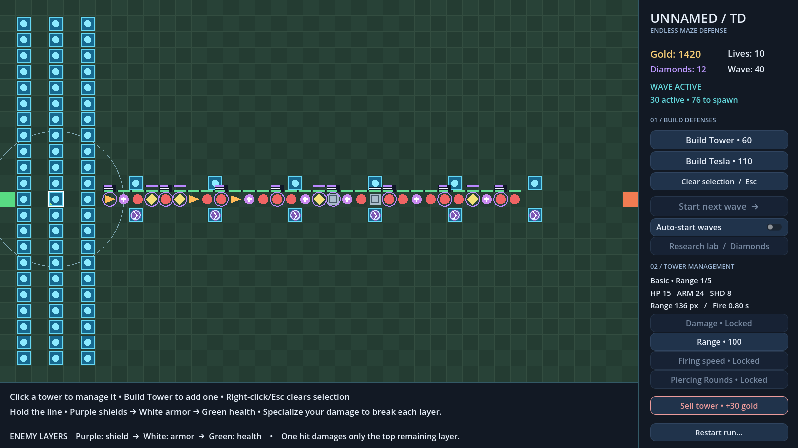
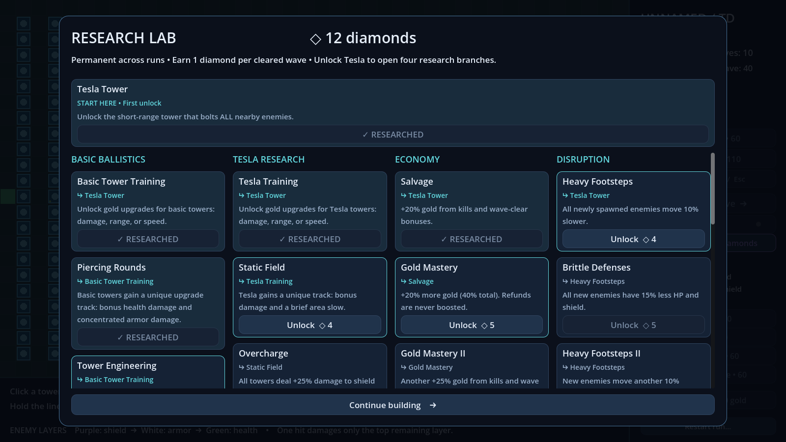
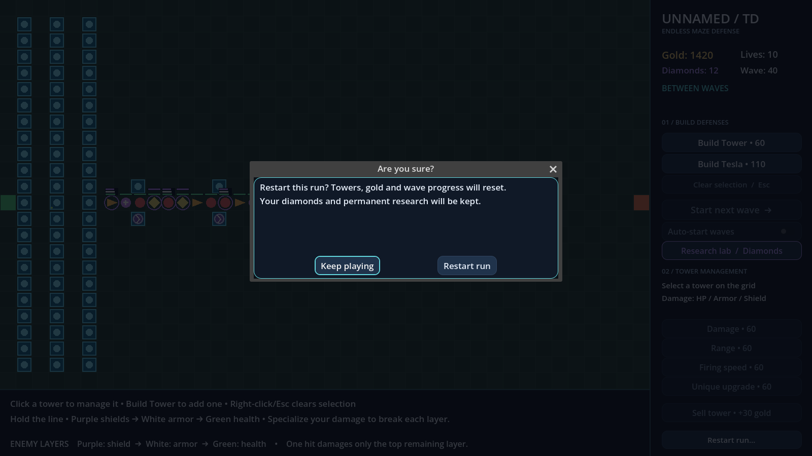

# v0.4 interface, layered defenses and denser waves

The HUD has a fixed sidebar/footer layout, rounded shared styling, distinct build/management sections, colored resource labels and a separated Sell action. The research menu has four scrolling branches, 26 permanent upgrades, visible prerequisites, increasing prices and a fixed header/footer. Existing profile schema and skill IDs remain valid.

Restart opens **Are you sure?**, dims the board and pauses tower/enemy/spawn processing. Keep playing, Escape or the close control cancels without resetting anything; confirming starts a fresh run and preserves permanent progress. Automatic wave progression waits for the decision.

## Rendered UI previews

These images were rendered by Godot 4.7.2 Stable using Linux X11 and Mesa software OpenGL. The capture fixture uses an isolated in-memory profile, injected gold and synthetic enemy bars to show all three defenses. It demonstrates presentation, not natural survival or an exported build. Windows F5 acceptance remains a manual check.







Optional reproduction on a machine with a rendered display (omit `--headless`):

```sh
godot --path . --rendering-method gl_compatibility --script res://tests/capture_ui.gd -- --output=user://ui-previews
```

The capture script refuses the headless dummy renderer rather than pretending to produce screenshots. No external fonts, plugins or game art were added. These preview PNGs are documentation only; `.gdignore` excludes this directory from game imports.

## Combat and late-wave behavior

Each enemy maintains independent health, armor and shield maxima. Bars stack from green health at the bottom through white armor to purple shield. Only the highest remaining layer takes damage; excess damage is discarded. Depleted bars disappear without relocating the lower bars. Armor is a consumable pool, replacing the prior flat damage reduction.

Unupgraded basic damage is **15 health / 24 armor / 8 shield**. Tesla damage is **12 / 6 / 24**, to all enemies within its radius per pulse. The selected-tower card reports all three stats. Gold damage tracks scale the derived stats; Piercing Rounds adds concentrated armor damage without bypassing the shield. Permanent specialization, engineering, range and firing-speed research updates placed towers as well as future towers. All gold upgrade tracks still require their tower's training, and each tower can choose only one track.

After wave 30, enemy counts grow faster than spawn frequency, so the spawning portion of waves gets longer while becoming denser:

| Wave | Enemies | Spawn spacing | Spawn window |
| --- | ---: | ---: | ---: |
| 31 | 68 | 0.660 s | 44.2 s |
| 40 | 106 | 0.540 s | 56.7 s |
| 50 | 152 | 0.459 s | 69.4 s |
| 75 | 284 | 0.347 s | 98.1 s |
| 100 | 442 | 0.284 s | 125.3 s |
| 110+ | 512 | 0.266 s | 135.9 s |

A wave also waits for the last enemy to die or escape. Counts/cadence plateau together at the resource budget; spawning duration never decreases as count rises. Health and defense pools retain the 1,000,000 safety cap. The generator clamps wave arithmetic before multiplication.

## Natural bot evidence

The existing policies were used without changing their purchase logic: an earned-skill/upgrade reference bot capped at 24 towers, and the basic-only hallway policy with no skills or upgrades. Each run used fresh in-memory progression, seed **721**, fixed **1/30 s** simulation steps, production movement/combat/economy, and a **200-wave** cap. No enemy speed, damage, gold, lives or counters were overridden. Towers were purchased between waves. The hallway policy completes its 426-tower / 476-cell route at wave 38 with the extra earned gold.

| Comparison | Reference clears / defeat wave | Hallway clears / defeat wave |
| --- | ---: | ---: |
| New layered defenses/density, original 0.04 veteran factor | 38 / **39** | 55 / **56** |
| Final 0.055 veteran factor | 38 / **39** | 54 / **55** |

The first comparison showed that removing permanent armor reduction let the hallway bot last longer. Raising post-30 health/defense pressure from `1 + 0.04*(wave-30)` to `1 + 0.055*(wave-30)` brought the winning defeat wave into the existing **45–55** calibration band without changing tower prices or damage again. In the final run, the hallway bot retained 10 lives through wave 51, then lost at wave 55. Its armored enemies reached 9,188 HP / 8,663 plating in that defeat wave.

Raw observations, source generator/config hashes and all per-wave counts are in [layered-baseline.json](layered-baseline.json) and [layered-tuned.json](layered-tuned.json). The final natural comparison exited 0 with `--assert-near-50`. These are one-seed measurements for fixed policies, not a limit on skilled players or profiles using the expanded research. Historical v0.3 outcomes remain in [the older report](../balance/README.md).

Actual final comparison command (substitute your local Godot executable):

```sh
godot --headless --path . --script res://tests/compare_endless.gd -- --report=user://layered-tuned.json --label=layered-density-pressure-0.055 --cap=200 --assert-near-50
```

## Regression coverage

Run the complete check runner:

```sh
python3 tests/run_checks.py --godot /path/to/Godot_v4.7.2-stable_linux.x86_64
```

The new `test_ui_and_layers.gd` exercises real viewport input and checks:

- Fixed rectangles for upgrade, Sell, build, start, research, selected text and status through a wave start/clear and large counters; footer text also stays fixed with long messages.
- A stationary cursor buying Range again after a wave clear, with the tower still present; all three stat lines remain visible.
- Restart confirmation, real Keep playing/Escape input, preserved resources, restored processing modes and deferred automatic progression; the existing reload test now clicks the actual confirmation button.
- Layer-specific damage, zero/negative damage, no overkill spill, once-only death, bar palette and real basic/Tesla shots against a three-layer fixture.
- All 26 skill prerequisites/costs, no duplicate purchases, old-save validity, expanded-save round-trip, permanent effects and immediate updates to placed towers.
- Late-wave count, acceleration, duration and extreme-index bounds.

The stability soak exercises **10,000 generated waves / 5,086,314 profiles**, **1,000 scheduled waves**, **300 scene lifecycle waves** and 100 build/remove cycles. Lifecycle fixtures intentionally resolve each layer separately to check cleanup and accounting; they are not balance evidence. Natural balance tests separately exercise five seeds: sensible placement cleared 30 waves with 10 lives; poor placement lost on wave 2 in every seed.

Final verification: **35,392 checks across 13 suites**, plus headless editor import/startup; no logged engine/script errors or leaks. The optional rendered captures also completed without engine/script errors (the virtual display reports an unsupported V-Sync warning). Open `project.godot` in 4.7.2 Stable and press F5 to verify window resizing, scroll/keyboard navigation, shield/armor depletion, and confirmation behavior on your own display.
