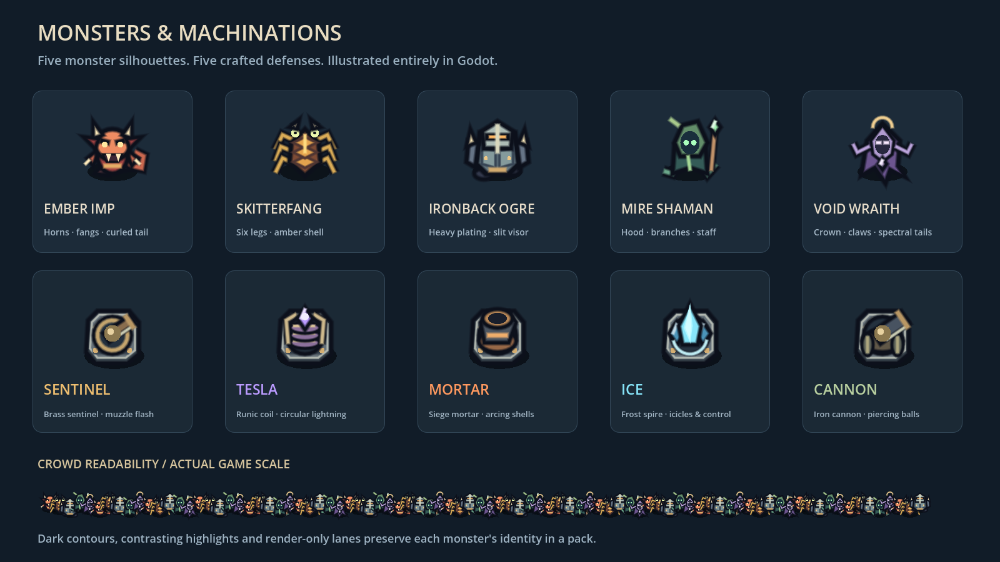
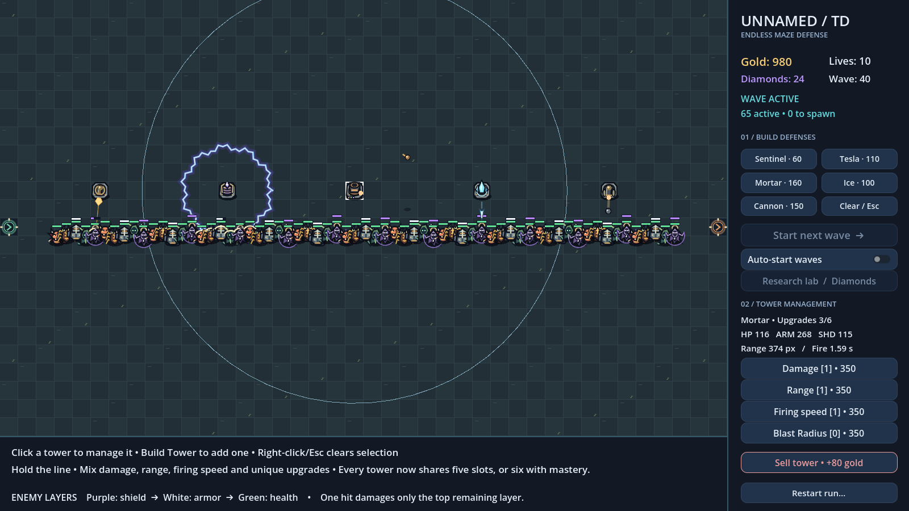
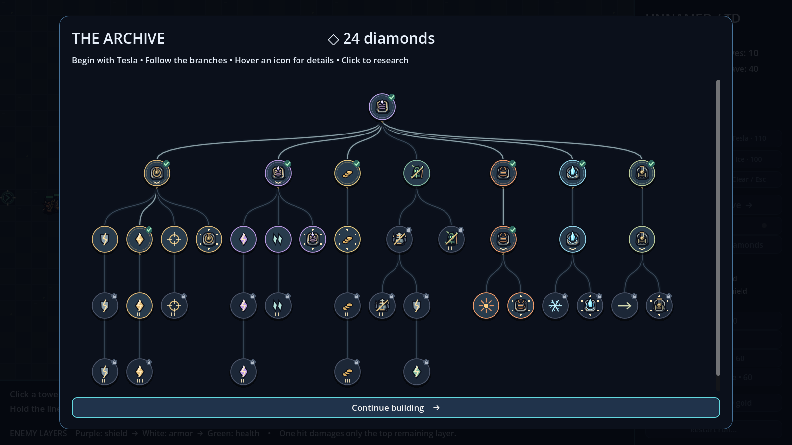
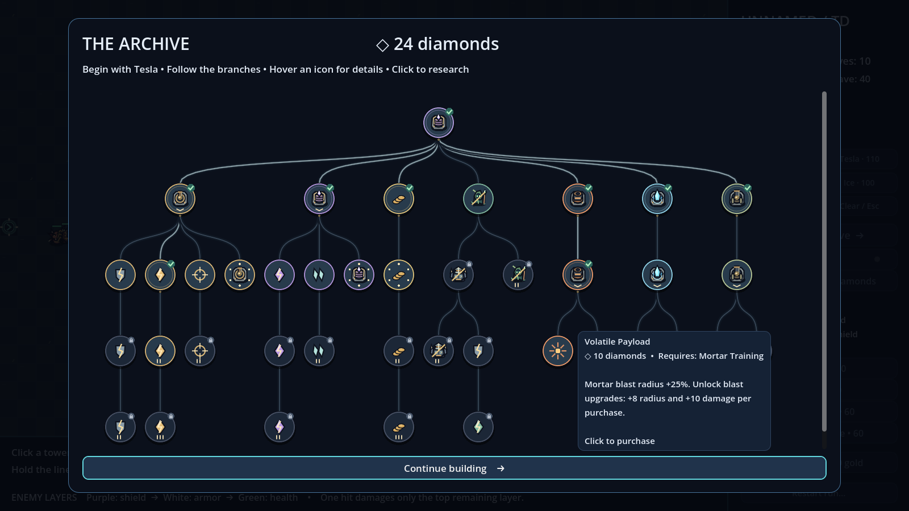
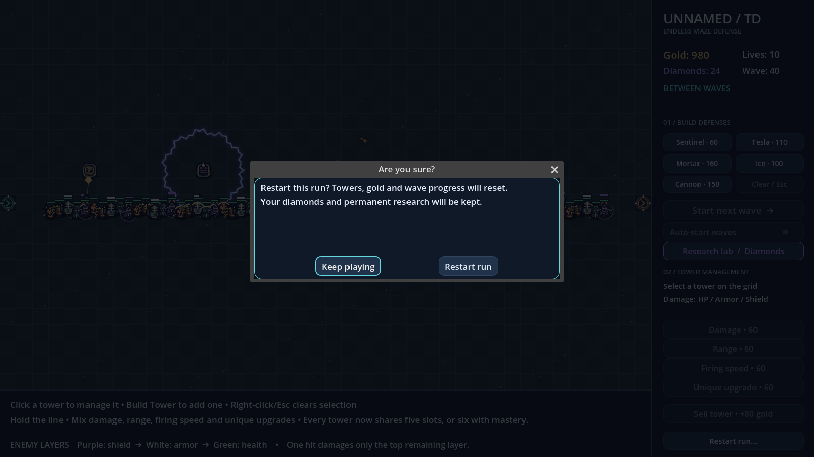

# v0.5 — Monsters & Machinations

Original Godot vector illustrations replace the geometric enemies/towers. The five monster archetypes are Ember Imp, Skitterfang, Ironback Ogre, Mire Shaman and Void Wraith. They have different silhouettes, palettes, equipment, outlines, shadows and limb animation. Small render-only lanes and compact defense bars help dense crowds remain readable without altering grid navigation or collision positions.



## Five defenses and new effects

- **Sentinel:** brass mechanism, aimed barrel, recoil, muzzle flash and brief tracer. Its original instantaneous shot timing/damage is retained.
- **Tesla:** runic coil and a jagged lightning circle around the tower. Every enemy in range is hit once per discharge; the effect draws no individual enemy-targeted bolts.
- **Mortar:** long-range shell with a parabolic visual arc and shadow. It lands at the target's launch-time position, deals one AoE hit, then shows a fading blast. Moving enemies can escape the impact area. Base range 280 px / blast radius 64 px / cost 160 gold.
- **Ice:** crystal spire firing homing icicles. Impacts slow 35% for 2 seconds. Glacial Heart research adds an 8% chance of a 0.5-second hard freeze. Base range 136 px / cost 100 gold.
- **Cannon:** iron barrel on a wheeled carriage. Cannonballs pierce each enemy once, but stop at the first friendly tower. Swept collision includes the ball radius and works across large time steps. Base range 176 px / travel 320 px / cost 150 gold.



All five types have independent health/armor/shield damage values, trainable mixed upgrades and 50% construction refunds. The existing purple shield → white armor → green health rules remain strict: one hit affects only the top remaining layer.

Mortar **Volatile Payload** research adds 25% blast radius. Ice **Glacial Heart** adds a small freeze chance. Cannon **Rifled Bore** adds 50% projectile travel distance. Each ability also unlocks its type's Unique gold upgrades. Tower-specific Mastery adds a sixth upgrade slot. The [main README](../../README.md) lists costs, effects, prerequisites and controls.

## The Archive

The skill tree now consists of **40 branching icons**. Tesla Tower remains the sole first unlock at 3 diamonds. Curved prerequisite edges and color-coded branches move with the scrolling canvas. Each icon has its own nonoverlapping hit area, owned/available/locked styling and a drawn symbol. Text for an individual upgrade is visible only on hover or keyboard focus. Click an eligible icon to purchase immediately; invalid or duplicate clicks cannot spend diamonds.





The graph also supports tab navigation and follows focused nodes when scrolling. Keyboard focus starts on its Close button; background research/restart/build controls are disabled while the modal is open. Hover cards ignore clicks and are clamped inside the logical screen after wrapped text lays out. Save errors and retry remain visible independently of upgrade information.

## Shared upgrade budget

Towers can mix **five total purchases** of Damage, Range, Speed and researched Unique upgrades. There is no single-category lock. For example, 2 Damage + 1 Range + 1 Speed + 1 Unique fills five slots. The price depends on total purchases, so switching categories cannot reset the price curve. The selected card shows used/maximum slots, and buttons show each category's count.

Each tower type has a separate Mastery research node that enables purchase **six** on existing and future towers of that type. Six is a hard limit. Its own training and unique-ability gates still apply. Upgrade spending is not refunded on sale. Existing profile schema/skill IDs remain compatible; the new budget applies to run-only tower state, which was never saved across restarts.

## Verification actually run

Godot **4.7.2.stable.official.ed1daf0bf**, Linux:

```sh
python3 tests/run_checks.py --godot /workspace/tools/godot-4.7.2/Godot_v4.7.2-stable_linux.x86_64
```

**36,590 checks across 15 suites passed**, plus editor import and 180-frame startup. The runner rejected logged engine/script/leak errors as well as failed assertions and nonzero exits.

New/updated coverage includes:

- Mortar flight, landing-only damage, inclusive AoE boundary, off-radius exclusion, once-only damage, radius research, dead targets and sold sources.
- Ice projectile delay, guaranteed slow, partial-frame freeze/slow interaction, safe waypoint reservations, invalid/bounded freeze duration, seeded freeze chance, missing research and expired targets.
- Cannon piercing over multiple frames, finite distance, friendly-tower blocking before later enemies, live tower construction/removal, ball-radius-aware swept collision, forward/reverse/parallel geometry and research distance.
- Mixed counts, total-price accounting, all five training gates, five-slot limits, existing-tower mastery refresh, all five sixth prices and seventh-purchase rejection.
- Projectile snapshot damage, lifetime/group cleanup over 80 blast cycles, production-wave cleanup and all three projectile types paused by restart confirmation.
- Actual icon hover/click input, hover-only descriptions, Tesla-first eligibility, prerequisites, duplicate/locked purchases, forty node positions, every pair of nonoverlapping icon hit areas, tooltip bounds, keyboard modality and stable build controls.
- Existing movement, maze placement, layer damage, restart, progression saving/recovery, auto-start and natural-placement regressions.

The long-run suite covers 10,000 generated waves / **5,086,314 profiles**, 1,000 scheduled waves, 300 scene lifecycles and 100 moving-enemy build/remove cycles. Five fixed seeds still passed the original placement regression: the sensible Sentinel/Tesla policy cleared 30 waves with 10 lives, and the off-route policy lost on wave 2. These bots do not buy the new types; **no full endless calibration for new tower combinations is claimed**.

## Reproducing the previews

The previews were rendered using Godot's real Compatibility renderer on Linux X11 with Mesa software OpenGL, then visually inspected. They contain an isolated, deliberately funded presentation fixture and a dense mixed crowd, not a naturally earned run. Artwork is drawn by `monster_art.gd`, `tower_art.gd` and `draw_kit.gd`; no art/font downloads or plugins were introduced. Documentation PNGs are excluded from game imports by `.gdignore`.

Run on a machine with a rendered display, without `--headless`:

```sh
godot --path . --rendering-method gl_compatibility --script res://tests/capture_ui.gd -- --output=user://visual-previews
```

Actual cloud capture used the same command with the pinned Godot binary, `DISPLAY=:99`, software OpenGL and an output path under this documentation folder. All five captures completed without engine/script errors. The virtual display emitted only its unsupported V-Sync warning.

Restart confirmation remains present and pauses all combat/effects until confirmed or canceled:



For interactive acceptance, open `project.godot` in Godot 4.7.2 Stable and press **F5**. Verify monster silhouettes in crowds, circular lightning, shell arcs/blasts, icicle slows/freezes, cannon piercing/blocking, hovered icon purchases, mixed upgrades and sixth-slot research. Windows F5 acceptance, GPU performance testing across hardware and export were not run.
